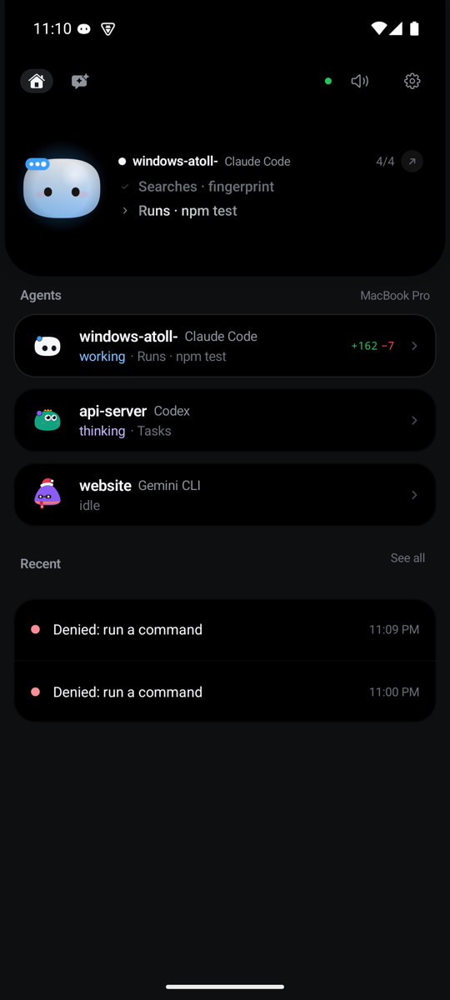
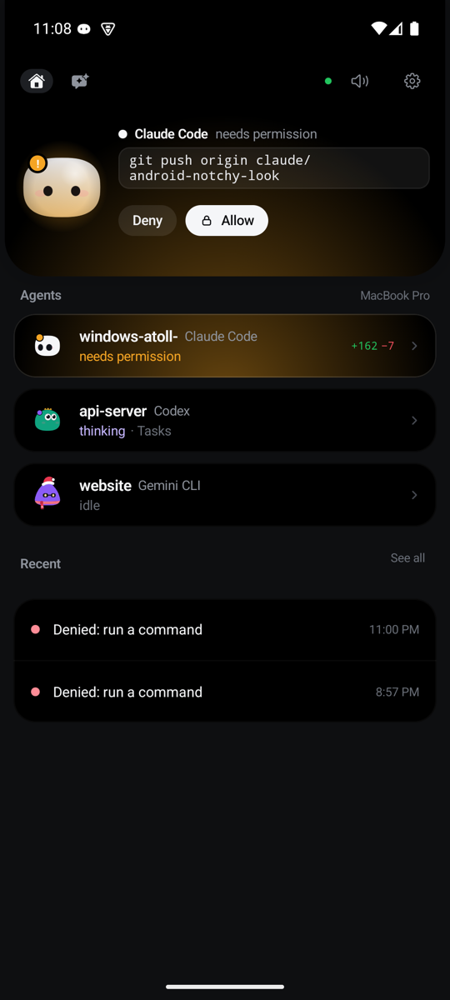
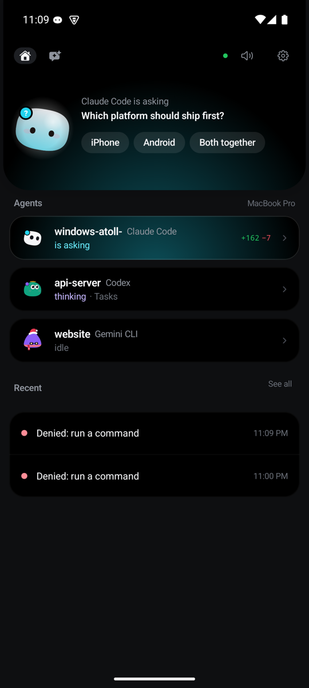
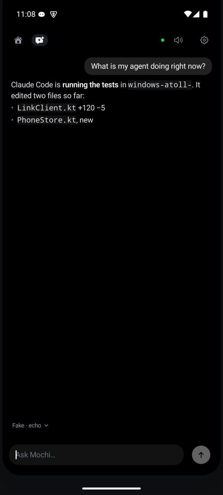

# Notchy on Android

Your computer does the work; your phone keeps you in the loop when you step away. Notchy for Android shows your agent sessions as
Mochi, lets you **Allow** or **Deny** a permission request from the notification or the app, answers Claude Code's questions, and can
chat through your computer's AI providers.

The phone talks to your computer **directly, over your own Wi-Fi**. There is no account, no server and no relay in between, and
nothing is sent anywhere else.

## What you need

| | |
|---|---|
| **Phone** | Android 11 or later |
| **Computer** | Notchy on a Mac, with the phone link (Settings → General → **Phone**). Windows and Linux do not have it yet |
| **Network** | The phone and the computer on the **same Wi-Fi** |

## Install

1. On the phone, open the [Releases](https://github.com/cauarat/windows-atoll-/releases) page and download the newest
   `Notchy-Android-<version>.apk` (an `android-v…` release).
2. Open the downloaded file. Android asks to allow installs from your browser or file manager the first time: allow it, then
   **Install**.
3. Open Notchy and allow notifications. That is how permission requests, questions and finished turns reach you.

## Pair it with your computer

1. On the Mac, open Notchy's **Settings → General → Phone** and turn on **Show my agent sessions on my phone**. It is off by
   default, and listens on your local network only. If macOS asks whether Notchy may accept incoming connections or find devices
   on your local network, allow it.
2. Click **Show the pairing code**. A QR code appears.
3. On the phone, tap **Scan QR code** and point the camera at it (or scan it with the phone's own camera app, or paste the link).
   The phone names the computer and asks you to confirm.
4. Start an agent session on the computer. It shows up on the phone within a second or two.

Pairing again on the computer replaces the code: the phone that had the old one is disconnected.

## What you can do

| On the phone | How |
|---|---|
| **Follow every session live** | Home: the island with Mochi and the session in focus, then one card per agent, each Mochi in the character its pill wears on the computer |
| **Allow or Deny a permission** | From the notification or the sheet that rises in the app. Allow asks for your fingerprint or screen lock. The computer only applies a decision meant for the exact command it is waiting on, and a request expires after 2 minutes |
| **Answer Claude's questions** | When the computer allows it: pick the choices on the phone, behind your screen lock |
| **See what changed** | When the computer allows it: the steps of a session, the files it changed and their diffs |
| **Chat** | When the computer allows it: talk to the providers set up on the computer. Its API keys never leave the computer |
| **Mochi over other apps** | Optional: a small island from the camera cut-out while an agent works |
| **Widgets** | Mochi at a glance, All your agents, Mochi, big, One-line status, Approvals waiting, Plan usage, Finished today, Mochi's mood, Your team |

Each extra (questions, details, file changes, chat, plan usage) has its own switch on the computer, and all of them are off by default.

## Troubleshooting

**The phone says "Connecting…" or cannot find the computer**
- The phone and the computer must be on the same Wi-Fi. Guest networks and hotspots often keep devices apart ("client isolation").
- Notchy must be running on the computer with the phone link on, and the computer awake.
- A firewall must let Notchy accept connections on your private network.
- In the app: **Settings → Computer → Can't connect?** checks each step and says which one fails. You can also type the computer's
  address by hand.

**Requests do not arrive while the screen is off**
- Android may put the app to sleep. Set Notchy's battery use to **Unrestricted** (Settings → Apps → Notchy → Battery). The app
  suggests it only when it would help.

**No notifications**
- Allow notifications for Notchy in Android's settings. Do Not Disturb hides them unless Notchy is allowed through.

**Nothing to approve**
- Claude Code must be in a mode that asks for permission. In auto or bypass mode it never asks, so nothing reaches the phone.

## Privacy

- The link is TLS, pinned to your computer's own certificate, and the pairing code never leaves the phone and the computer.
- The phone never receives your API keys, full paths, or file contents unless you turned the matching switch on.
- No account, no analytics, no ads.

Building it yourself: [`android/README.md`](../android/README.md).
