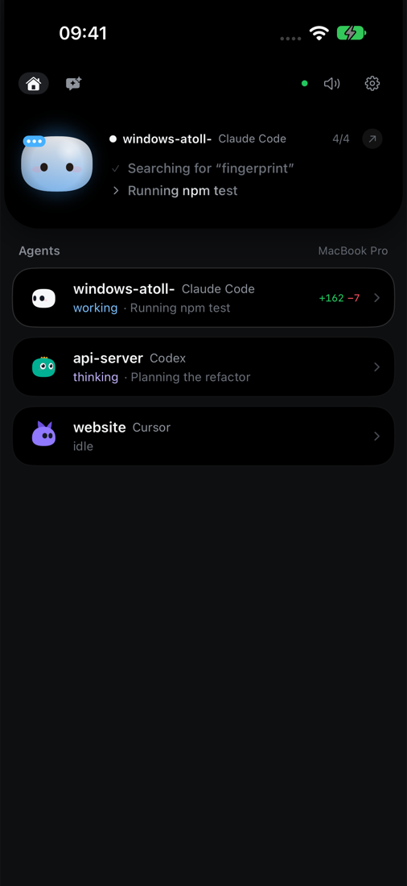
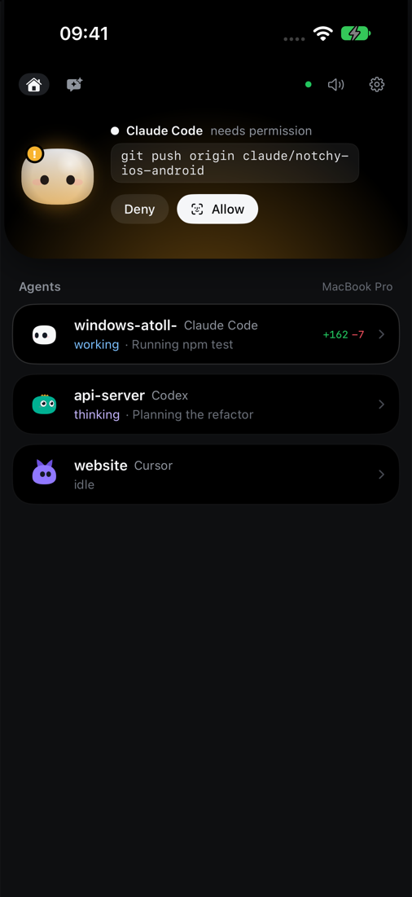
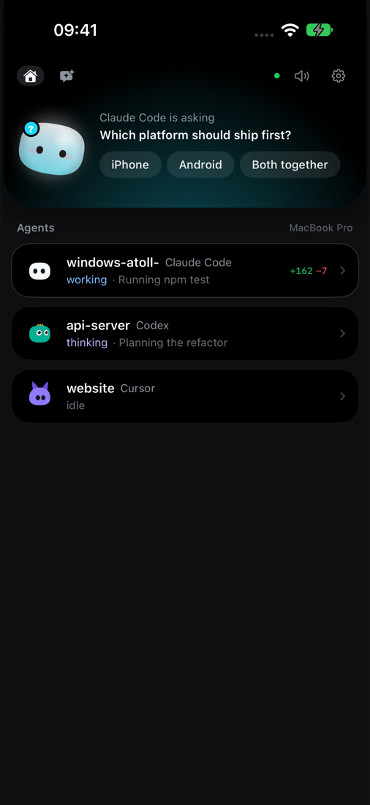

# Notchy on iPhone

Your computer does the work; Mochi keeps you in the loop on your iPhone: your agents live, a permission
request you can deny or allow (with Face ID), Claude's questions, the files an agent changed, and a chat
with Mochi through the AI providers set up on your computer.

The iPhone connects to Notchy on your computer **directly, over your local network**. There is no
account, no server and no iCloud in between.

## What you need

| | |
|---|---|
| **Computer** | Notchy on your Mac, Windows PC or Linux, with this version or later |
| **iPhone** | iOS 17 or later, on the **same Wi-Fi** as the computer |
| **Notchy for iPhone** | one of the three ways below |

## Get it on your iPhone

There is no App Store version. Three ways, from the simplest to the one that needs a paid account:

### 1. From Xcode, with a free Apple ID (your own iPhone)

1. Install Xcode and [XcodeGen](https://github.com/yonaskolb/XcodeGen) (`brew install xcodegen`).
2. `cd ios && xcodegen && open NotchyPhone.xcodeproj`
3. Plug in your iPhone (or pair it over Wi-Fi in Xcode's Devices window) and turn on **Developer Mode** on
   it (Settings → Privacy & Security).
4. In Xcode, select the **Notchy** target → Signing & Capabilities → Team: your Apple ID ("Personal
   Team"). Do the same for **NotchyWidgets**. If Xcode says the bundle identifier is taken, change
   `com.cauarati.NotchyPhone` to something of your own in both targets (the widget's must start with the
   app's).
5. Pick your iPhone as the destination and press Run. The first time, trust your developer certificate on
   the iPhone: Settings → General → VPN & Device Management.

A free Apple ID signs the app for **7 days**: run it from Xcode again after that.

### 2. SideStore or AltStore, with the `.ipa` (no Mac needed after setup)

Every `ios-v*` release on GitHub carries an unsigned `Notchy.ipa`. [SideStore](https://sidestore.io) or
[AltStore](https://altstore.io) sign it with your own free Apple ID and refresh it every 7 days by
themselves. Install one of them (their sites explain how), then open `Notchy.ipa` with it.

### 3. TestFlight (needs an Apple Developer Program membership, $99/year)

With a paid membership, `ios/scripts/testflight.sh` archives the app and uploads it to App Store Connect;
from there TestFlight can send it to up to 10,000 testers with a public link, the way Coucou does. See the
script's header for the one-time setup (an App Store Connect API key and your team ID).

## Pair it with your computer

1. **On the computer:** the menu bar icon on a Mac, the icon by the clock on Windows and Linux →
   **Settings… → General → Phone**, turn on **Show my agent sessions on my phone**, then click **Show the
   pairing code**. On Windows, allow Notchy on private networks when the firewall asks.
2. **On the iPhone:** open Notchy, tap **Scan the pairing code** and point it at the QR code (or copy the
   link under it on the computer, and tap **Paste the link**). Notchy names the computer and asks before it
   pairs.
3. Allow notifications and local network access when the iPhone asks.

Optional switches on the computer, in the same box: session details (every step), the files an agent changed
(with their diffs), answering Claude Code's questions, and chatting with your AI providers.

## What you can do

| | |
|---|---|
| **Follow every session** | The island at the top of the screen shows the session in focus with its live ticker; every agent is listed under it with its own Mochi, in its pill's colour and character |
| **Allow or Deny** | The island turns amber with the command. Deny goes at once; Allow asks for Face ID first. A command longer than the phone can show can only be denied from the phone |
| **Answer Claude** | Its question and choices show in the island; your answer asks for Face ID first |
| **Read the diffs** | Open a session, tap a file |
| **Chat with Mochi** | The chat tab, with the provider and model set up on your computer. Your keys never leave it |
| **Mochi on the Lock Screen** | While an agent works and Notchy is open, Mochi goes to the Lock Screen and the Dynamic Island (Settings → Mochi on the Lock Screen) |

## The honest limit: the iPhone in your pocket

Without a push server, the iPhone hears from your computer while Notchy is open and for the short time
iOS leaves an app after it goes to the background. A request that arrives later waits on the computer's island
as usual and shows up on the phone the next time you open Notchy. (Android keeps its link up in the
background; iOS does not allow that without Apple's push service, which needs a paid developer account.)

## Privacy

- The phone talks only to your computer, over your network, in a TLS connection pinned to your computer's
  own certificate. The pairing secret lives in the iPhone's Keychain.
- No account, no analytics, no server. Unpairing on the phone (Settings → Unpair) or **Pair again** on the
  computer ends it.
- Never sent to the phone: a prompt, a command's output, file contents, full paths, API keys.

## Troubleshooting

**The iPhone cannot find the computer**
- Same Wi-Fi on both? Guest networks and some routers keep devices from seeing each other.
- Notchy running on the computer, with **Show my agent sessions on my phone** on?
- Did the iPhone ask for **local network** access? If you said no: iPhone Settings → Privacy & Security →
  Local Network → Notchy.
- A firewall on the computer must let Notchy accept incoming connections (on Windows: on private networks).

**"Not paired any more"** — the computer made a new pairing code. Scan it again.

**Allow does nothing** — the iPhone needs Face ID, Touch ID or a passcode set up.

## Build it yourself

`ios/project.yml` is the XcodeGen spec (the Xcode project is generated, not committed). The app compiles
the Mac's own Mochi sources from `NotchBuddy/Sources/App` (BotEngine, MochiShape, MochiCharacter…), so the
character is the island's line for line; `ios/Shared/MacShims.swift` supplies the few AppKit names they
expect. The link protocol is in [PHONE_LINK.md](PHONE_LINK.md).

For screenshots without a computer, a Debug build reads `NOTCHY_DEMO=sessions|approval|question|finished|chat`.
