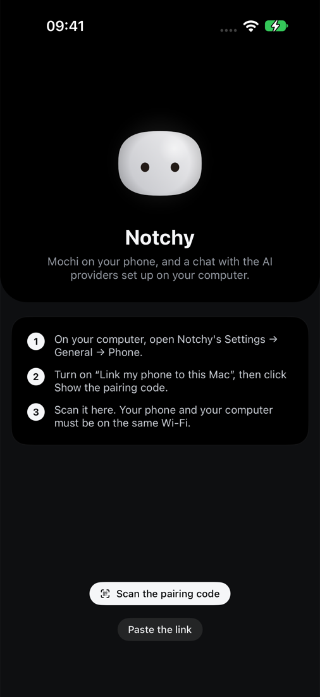
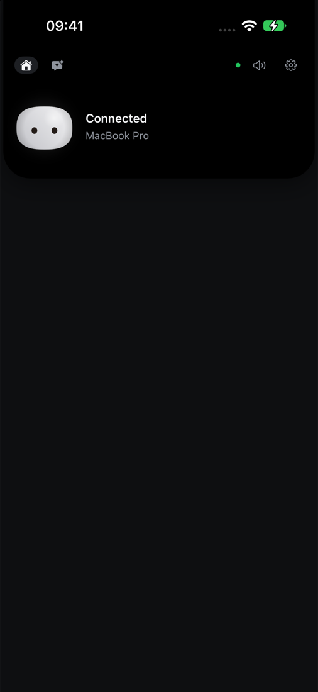
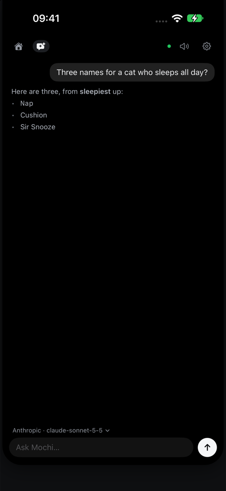

# Notchy on iPhone

Mochi on your iPhone, and a chat with him through the AI providers set up on your computer. Your keys
stay on the computer.

The iPhone connects to Notchy on your computer **directly, over your local network**. There is no
account, no server and no iCloud in between.

## What you need

| | |
|---|---|
| **Computer** | Notchy on your Mac, with this version or later |
| **iPhone** | iOS 17 or later, on the **same Wi-Fi** as the Mac |
| **Notchy for iPhone** | one of the three ways below |

## Get it on your iPhone

There is no App Store version. Three ways, from the simplest to the one that needs a paid account:

### 1. From Xcode, with a free Apple ID (your own iPhone)

1. Install Xcode and [XcodeGen](https://github.com/yonaskolb/XcodeGen) (`brew install xcodegen`).
2. `cd ios && xcodegen && open NotchyPhone.xcodeproj`
3. Plug in your iPhone (or pair it over Wi-Fi in Xcode's Devices window) and turn on **Developer Mode** on
   it (Settings → Privacy & Security).
4. In Xcode, select the **Notchy** target → Signing & Capabilities → Team: your Apple ID ("Personal
   Team"). If Xcode says the bundle identifier is taken, change `com.cauarati.NotchyPhone` to something of
   your own.
5. Pick your iPhone as the destination and press Run. The first time, trust your developer certificate on
   the iPhone: Settings → General → VPN & Device Management.

A free Apple ID signs the app for **7 days**: run it from Xcode again after that.

### 2. SideStore or AltStore, with the `.ipa` (no Mac needed after setup)

Every `ios-v*` release on GitHub carries an unsigned `Notchy.ipa`. [SideStore](https://sidestore.io) or
[AltStore](https://altstore.io) sign it with your own free Apple ID and refresh it every 7 days by
themselves. Install one of them (their sites explain how), then open `Notchy.ipa` with it.

### 3. TestFlight (needs an Apple Developer Program membership, $99/year)

With a paid membership, `ios/scripts/testflight.sh` archives the app and uploads it to App Store Connect;
from there TestFlight can send it to up to 10,000 testers with a public link, the way Coucou does. See the
script's header for the one-time setup (an App Store Connect API key and your team ID).

## Pair it with your computer

1. **On the Mac:** menu bar icon → **Settings… → General → Phone**, turn on **Link my phone to this
   Mac**, then click **Show the pairing code**.
2. **On the iPhone:** open Notchy, tap **Scan the pairing code** and point it at the QR code (or copy the
   link under it on the Mac, and tap **Paste the link**). Notchy names the computer and asks before it
   pairs.
3. Allow local network access when the iPhone asks.

To chat from the phone, also turn on **Let the phone chat with my AI providers** in the same box.

## What you can do

| | |
|---|---|
| **Chat with Mochi** | The chat tab, with the provider and model set up on your Mac. Your keys never leave the Mac |
| **See the link** | The island at the top of the screen says whether the phone has reached your computer, by name; Mochi naps while it has not. Pull down to try again |

## While Notchy is closed

The iPhone is connected to your computer while Notchy is open, and for the short time iOS leaves an app
after it goes to the background, so an answer still arriving when you put the phone away is there when you
come back. With Notchy closed, nothing reaches the phone: there is no push server.

## Privacy

- The phone talks only to your computer, over your network, in a TLS connection pinned to your computer's
  own certificate. The pairing secret lives in the iPhone's Keychain.
- No account, no analytics, no server. Unpairing on the phone (Settings → Unpair) or **Pair again** on the
  Mac ends it.
- The chat's provider is called from your computer, with your computer's key: no key ever reaches the
  phone. The phone keeps the conversation in memory only.

## Troubleshooting

**"Looking for your Mac…"**
- Same Wi-Fi on both? Guest networks and some routers keep devices from seeing each other.
- Notchy running on the Mac, with **Link my phone to this Mac** on?
- Did the iPhone ask for **local network** access? If you said no: iPhone Settings → Privacy & Security →
  Local Network → Notchy.
- A firewall on the Mac must let Notchy accept incoming connections.

**"Not paired any more"** — the Mac made a new pairing code. Scan it again.

**"Chat from the phone is off"** — turn on **Let the phone chat with my AI providers** on the Mac.

## Build it yourself

`ios/project.yml` is the XcodeGen spec (the Xcode project is generated, not committed). The app compiles
the Mac's own Mochi sources from `NotchBuddy/Sources/App` (BotEngine, MochiShape, MochiCharacter…), so the
character is the island's line for line; `ios/Notchy/Mochi/MacShims.swift` supplies the few AppKit names
they expect. The link protocol is in [PHONE_LINK.md](PHONE_LINK.md).

For screenshots without a computer, a Debug build reads `NOTCHY_DEMO=home|chat`.
